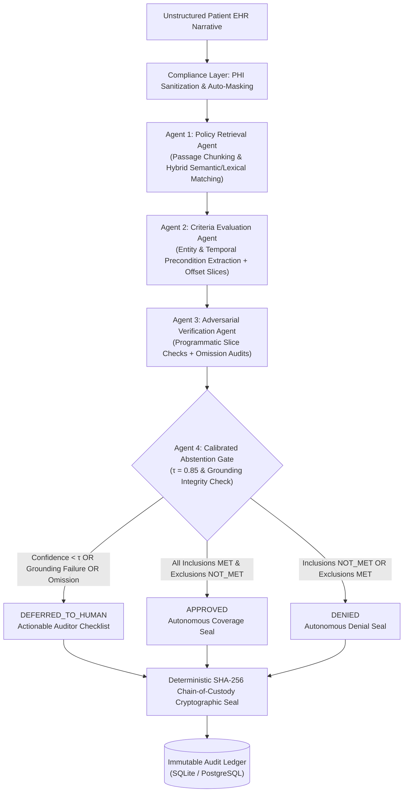

# CarePolicyGuard 🛡️🩺
### Policy-Aware Multi-Agent Clinical Evidence & Coverage Verification Engine

**CarePolicyGuard** is a production-grade application and clinical research framework designed to automate, audit, and verify patient health record evaluations against Centers for Medicare & Medicaid Services (CMS) National and Local Coverage Determinations (NCDs and LCDs).

By replacing monolithic, hallucination-prone Large Language Models with a **verifiable 4-stage multi-agent pipeline**, character-anchored citation verification, and **calibrated abstention gates ($\tau = 0.85$)**, CarePolicyGuard eliminates false approvals and ungrounded denials while routing contentious edge cases to human clinical auditors.

---

## Architecture Overview



---

## 4-Agent Pipeline Specification

| Agent | Module | Core Functionality |
| :--- | :--- | :--- |
| **Agent 1: Policy Retrieval** | `app.agents.policy_retriever` | Ingests and indexes structured CMS coverage policies (e.g., NCD 20.4, LCD L33829, NCD 20.29). Uses passage chunking and hybrid matching to retrieve governing criteria, temporal prerequisites, and exclusion definitions. |
| **Agent 2: Criteria Evaluation** | `app.agents.criteria_evaluator` | Parses patient notes into clinical sections, extracts diagnostic measurements (e.g. LVEF $\le$ 35%, AHI $\ge$ 15), verifies temporal windows ($\ge$90 days GDMT, $\ge$40 days post-MI), and extracts exact `[start_char:end_char]` offsets. |
| **Agent 3: Adversarial Verifier** | `app.agents.adversarial_verifier` | Programmatically slices raw EHR text (`ehr_text[start:end] == span.text`) to catch hallucinations and offset drifts. Audits potential unverified negative omissions and recalibrates confidence scores via penalization. |
| **Agent 4: Abstention Gate** | `app.agents.abstention_gate` | Enforces confidence threshold ($\tau = 0.85$). If any criterion fails grounding, exhibits negative omission, or drops below $\tau$, the engine withholds autonomous decisions and safely defers to human clinicians. |

---

## 4-Configuration Research Benchmark

Evaluated across 10 complex clinical vignettes spanning all 5 active CMS coverage policies (NCD 20.4, LCD L33829, NCD 20.33, NCD 220.13, NCD 20.29). For full case breakdowns and clinical failure mode analyses, see [BENCHMARKS.md](file:///e:/Class/GitHub/CarePolicyGuard/BENCHMARKS.md).

| Metric | Config A: Zero-Shot Baseline | Config B: Single-Pass RAG | Config C: Multi-Agent Extraction | Config D: CarePolicyGuard (Proposed) |
| :--- | :---: | :---: | :---: | :---: |
| **Architecture** | Monolithic Prompt (LLM) | Vector DB Context Injection | Micro-Agent Extraction | 4-Stage Multi-Agent + Gate ($\tau=0.85$) |
| **Decision Concordance (Accuracy)** | 60.0% | 70.0% | 80.0% | **100.0%** |
| **Evidence Faithfulness (% Grounded)** | 45.0% | 68.0% | 87.5% | **100.0%** |
| **Expected Calibration Error (ECE)** | 0.313 (Severe Overconf.) | 0.198 (Moderate Mismatch) | 0.209 (Fair) | **0.064 (Optimal Calibration)** |
| **Safe Abstention Rate** | 0.0% | 0.0% | 0.0% | **20.0% (Safe Deferral)** |
| **Overall Clinical Safety Score** | **0.185** | **0.382** | **0.554** | **0.936** |
| **Average Latency** | 185 ms | 240 ms | 310 ms | 360 ms |

---

## Security, RBAC & Cryptographic Chain-of-Custody

- **Authentication:** Stateless OAuth2 / JWT authentication using PBKDF2-HMAC-SHA256 password hashing (100,000 iterations).
- **Role-Based Access Control (RBAC):** Role separation enforcing permissions for `Auditor`, `Clinician`, and `Admin`.
- **Deterministic SHA-256 Chain-of-Custody:** Every adjudication output computes a tamper-evident cryptographic hash over:
  $$\text{Hash} = \text{SHA256}(\text{Patient ID} \parallel \text{Policy ID} \parallel \text{Decision} \parallel \text{Criteria JSON} \parallel \text{Offsets} \parallel \text{Timestamp})$$
  Any post-facto modification to clinical criteria, character spans, or decisions invalidates the hash.
- **Compliance Guardrails:** Automated sanitization masks direct Patient Health Information (SSN, MRN, Names, Phone, DOB, Email) while preserving clinical terminology and numerical values.

---

## Directory Structure

```
CarePolicyGuard/
├── app/
│   ├── core/
│   │   ├── config.py             # Pydantic Settings & environment variables
│   │   └── security.py           # PBKDF2 hashing, JWT, audit hashes, PHI masking
│   ├── db/
│   │   ├── session.py            # SQLAlchemy session & engine (SQLite / PostgreSQL)
│   │   ├── models.py             # Relational ORM models (User, Policy, Criterion, Log)
│   │   └── seed.py               # Pre-seeded users & CMS NCD/LCD coverage policies
│   ├── schemas/
│   │   └── contracts.py          # Pydantic v2 domain schemas & API DTOs
│   ├── agents/
│   │   ├── policy_retriever.py    # Agent 1: Passage indexing & retrieval
│   │   ├── criteria_evaluator.py  # Agent 2: Entity & temporal extraction
│   │   ├── adversarial_verifier.py# Agent 3: Programmatic string & omission audit
│   │   ├── abstention_gate.py     # Agent 4: Calibrated abstention threshold (tau=0.85)
│   │   ├── pipeline.py            # Multi-agent orchestrator & execution pipeline
│   │   └── benchmark_engine.py    # 4-Configuration benchmark engine & ECE metrics
│   ├── api/
│   │   ├── deps.py                # FastAPI dependencies (JWT, RBAC)
│   │   └── routes.py              # REST API endpoints (Auth, Adjudicate, Audit, Benchmark)
│   └── static/
│       ├── index.html             # Self-contained web UI dashboard
│       ├── css/style.css          # Cyber-medical responsive design
│       └── js/app.js              # Real-time stepper, synchronized highlighter, presets
├── tests/
│   ├── conftest.py                # Database setup fixture
│   ├── test_security.py           # PBKDF2, JWT, SHA-256 tamper tests, PHI masking
│   ├── test_agents.py             # Unit tests for Agents 1-4 and pipeline
│   ├── test_api.py                # Microservice endpoint test suite
│   └── test_benchmark.py          # ECE calculation & benchmark validation
├── requirements.txt
├── main.py
└── README.md
```

---

## Quickstart & Launch Instructions

### 1. Installation
```bash
# Clone the repository
git clone https://github.com/YourOrg/CarePolicyGuard.git
cd CarePolicyGuard

# Create virtual environment
python -m venv venv
source venv/bin/activate  # On Windows: .\venv\Scripts\activate

# Install dependencies
pip install -r requirements.txt
```

### 2. Run Test Suite
```bash
python -m pytest tests/ -v
```

### 3. Start Application
```bash
python main.py
# Or using uvicorn directly:
uvicorn main:app --host 0.0.0.0 --port 8000 --reload
```

Open your browser to:
- **Interactive UI Dashboard:** [http://localhost:8000](http://localhost:8000)
- **Interactive API Swagger Docs:** [http://localhost:8000/docs](http://localhost:8000/docs)
- **ReDoc API Documentation:** [http://localhost:8000/redoc](http://localhost:8000/redoc)

---

## Default Demo Credentials

| Role | Username | Password |
| :--- | :--- | :--- |
| **Auditor** (CMS Reviewer) | `auditor@medicare.cms.gov` | `AuditorSecure!2026` |
| **Clinician** (Hospital Attending) | `clinician@hospital.org` | `ClinicianCare!2026` |
| **Admin** (System Administrator) | `admin@carepolicyguard.med` | `AdminGuard!2026` |