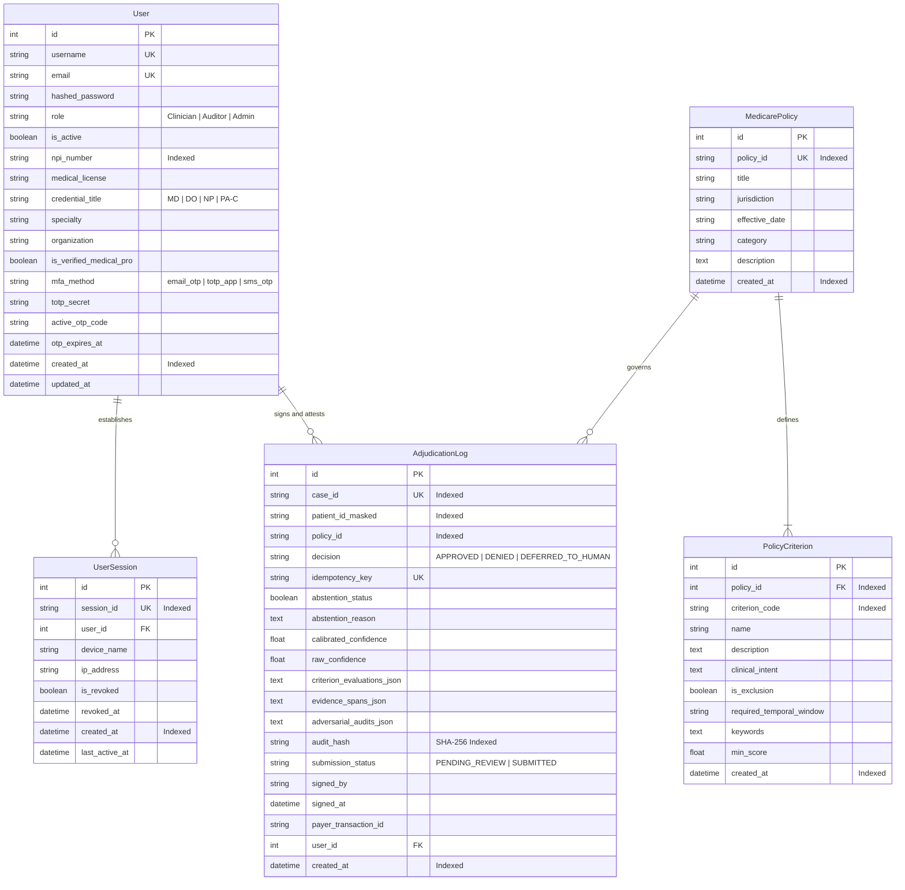
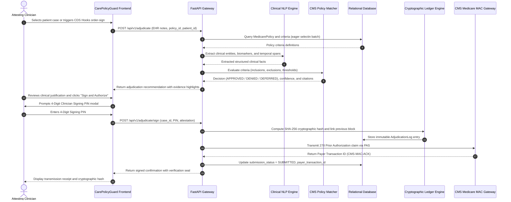
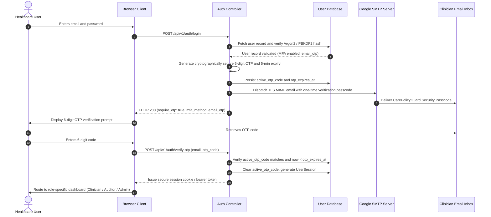
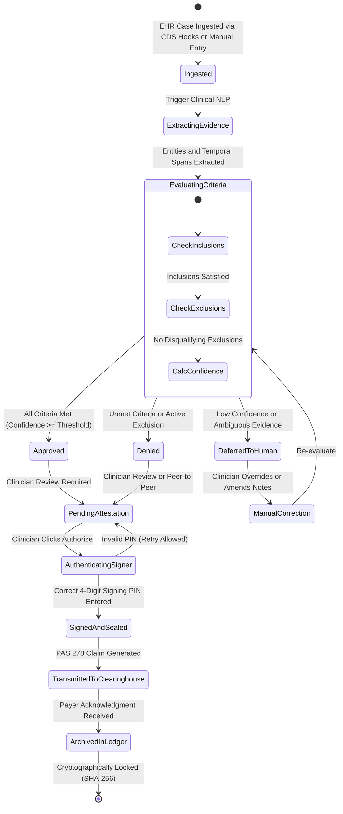
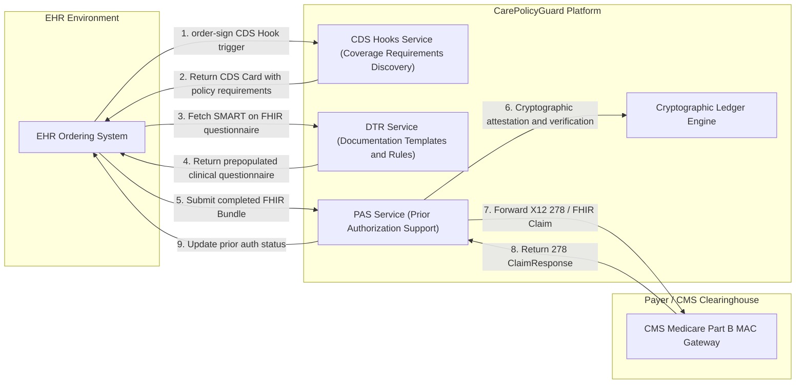

# CarePolicyGuard Architecture and Design Specification

This document provides visual architectural, relational, sequence, state, and interoperability diagrams for the **CarePolicyGuard** clinical adjudication and prior authorization attestation platform.

Standalone image files are saved directly in `docs/images/` as both **PNG** and **SVG** formats for use in presentations, reports, and documentation.

---

## 1. High-Level System Architecture

CarePolicyGuard is structured as a tiered, HIPAA-compliant prior authorization adjudication platform. It decouples interface concerns, API orchestration, deterministic clinical inference, cryptographic integrity auditing, and external healthcare integrations.

*Direct image files: [PNG](images/01_system_architecture.png) | [SVG](images/01_system_architecture.svg)*

```mermaid
flowchart TB
    %% -------------------------------------------------------------
    %% CLIENT & WORKSPACE LAYER
    %% -------------------------------------------------------------
    subgraph Layer1 ["1. Client & Interface Layer (Presentation)"]
        UI_Clinician["Clinician Workspace<br/>- Single Case Adjudication<br/>- 4-Digit Attestation PIN<br/>- Interactive EHR Evidence Highlight"]
        UI_Batch["Batch Roster Engine<br/>- Multi-Patient Roster Ingestion<br/>- Excel, CSV, PDF, RapidOCR Ingestion<br/>- High-Throughput Engine (~20ms)"]
        UI_Auditor["Regulatory Auditor Portal<br/>- Cross-System Audit Ledger<br/>- Cryptographic SHA-256 Seal Verification<br/>- Tamper-Evident Chain-of-Custody"]
        UI_EHR["EHR / CDS Hooks Client<br/>- SMART on FHIR Apps<br/>- Epic / Cerner / Allscripts<br/>- order-sign & order-select Hooks"]
    end

    %% -------------------------------------------------------------
    %% API GATEWAY & SECURITY LAYER
    %% -------------------------------------------------------------
    subgraph Layer2 ["2. API Gateway & Security Layer (FastAPI 0.115+)"]
        GW_Router["Reverse Proxy & Router<br/>- Async Route Dispatcher<br/>- Request Context Tracking"]
        GW_SecHeaders["OWASP Security Headers<br/>- CSP, HSTS, X-Frame-Options<br/>- HIPAA Security Standards"]
        GW_Auth["Auth & Identity Guard<br/>- Argon2 Password Hashing<br/>- JWT Bearer & Cookie Session<br/>- MFA Engine (TOTP / Live SMTP)"]
        GW_HIPAA["HIPAA Privacy Engine<br/>- Safe Harbor PHI Masker<br/>- Role-Based Minimum Necessary"]
        GW_Perf["Performance Middleware<br/>- GZip Compression (>=1KB)<br/>- Rate Limiter & Anti-Abuse Guard"]
    end

    %% -------------------------------------------------------------
    %% MULTI-AGENT ADJUDICATION PIPELINE
    %% -------------------------------------------------------------
    subgraph Layer3 ["3. Neuro-Symbolic Multi-Agent Pipeline (Deterministic Clinical AI)"]
        direction TB

        Agent1["Agent 1: Policy Retrieval Agent<br/>- CMS Medicare Coverage Database<br/>- National Coverage (NCD 20.4, 20.29, 240.2)<br/>- Local Coverage (LCD L33829)<br/>- Hybrid Lexical-Semantic Matching"]

        Agent2["Agent 2: Criteria Evaluation Agent<br/>- Deterministic Rule Matcher<br/>- NegEx Clinical Negation Scope<br/>- Phenotype Validation (HFrEF vs HFpEF)<br/>- Character Span Offsets [start:end]"]

        Agent3["Agent 3: Adversarial Verifier Agent<br/>- Byte-Level Substring Verification<br/>- assert ehr[start:end] == span.text<br/>- Hallucination & Drift Detection<br/>- Confidence Penalty Recalibration"]

        Agent4{"Agent 4: Calibrated Abstention Gate<br/>- Platt / Isotonic Calibration<br/>- Threshold: tau = 0.85<br/>- Hallucination Discordance Check"}

        Decision_Approved["Autonomous Approval<br/>- High Confidence (>= 0.85)<br/>- All Criteria Met<br/>- Instant Clearinghouse Claim"]
        Decision_Denied["Autonomous Denial<br/>- High Confidence (>= 0.85)<br/>- Disqualifying Exclusion Active<br/>- Prior-Event Waiting Period Flag"]
        Decision_Deferred["Clinical Deferral to MD<br/>- Low Confidence (< 0.85)<br/>- Ambiguous Evidence / Missing Data<br/>- Peer-to-Peer Review Queue"]

        Agent5["Agent 5: Defense Packet & Appeal Generator<br/>- CMS Prior Authorization Defense Packet<br/>- Character-Anchored Evidence Exhibits<br/>- CARC / RARC Billing Code Mapping<br/>- Formal Peer-to-Peer Appeal Letters"]
    end

    %% -------------------------------------------------------------
    %% PERSISTENCE & DATA LAYER
    %% -------------------------------------------------------------
    subgraph Layer4 ["4. Persistence, Cryptographic Audit & Standards Layer"]
        DB[("Relational Database<br/>- PostgreSQL / SQLite<br/>- Indexed Foreign Keys & Timestamps<br/>- Eager-Loaded selectin Batches")]
        
        Ledger["Immutable Audit Ledger<br/>- SHA-256 Merkle Block Chaining<br/>- Cryptographic Hash Seals<br/>- Tamper-Evident Audit Trail"]
        
        FHIR_Engine["HL7 DaVinci Interop Engine<br/>- CRD (Coverage Requirements Discovery)<br/>- DTR (Templates & Rules Questionnaire)<br/>- PAS (Prior Authorization Support 278)"]
    end

    %% -------------------------------------------------------------
    %% EXTERNAL HEALTHCARE INFRASTRUCTURE
    %% -------------------------------------------------------------
    subgraph Layer5 ["5. External Healthcare Infrastructure"]
        CMS_MAC["CMS Medicare MAC Clearinghouse<br/>- X12 EDI 278 Electronic Claim Gateway<br/>- Clearinghouse ClaimResponse Receipt"]
        SMTP_Server["Google SMTP Server<br/>- TLS 587 Live Email OTP Dispatch<br/>- Ephemeral 6-Digit Passcodes"]
        External_EHR["Hospital EHR Systems<br/>- FHIR R4 Patient Clinical Repositories"]
    end

    %% Flow connections
    Layer1 --> Layer2
    GW_Router --> GW_SecHeaders --> GW_Auth --> GW_HIPAA --> GW_Perf

    GW_Perf --> Agent1
    Agent1 --> Agent2
    Agent2 --> Agent3
    Agent3 --> Agent4

    Agent4 -- "Concordant Pass (>= 0.85)" --> Decision_Approved
    Agent4 -- "Disqualified Pass (>= 0.85)" --> Decision_Denied
    Agent4 -- "Uncertain / Discordant (< 0.85)" --> Decision_Deferred

    Decision_Approved --> Agent5
    Decision_Denied --> Agent5
    Decision_Deferred --> Agent5

    Agent5 --> DB
    Agent5 --> Ledger
    Agent5 --> FHIR_Engine

    GW_Auth -. "Live 2FA Dispatch" .-> SMTP_Server
    FHIR_Engine -. "X12 278 Electronic Claim" .-> CMS_MAC
    UI_EHR <-. "SMART on FHIR Launch" .-> External_EHR
```

---

## 2. Entity-Relationship Data Model (ERD)

The data model enforces relational integrity across users, sessions, national/local Medicare coverage determinations, individual criteria, and immutable adjudication ledgers.

*Direct image files: [PNG](images/02_entity_relationship_erd.png) | [SVG](images/02_entity_relationship_erd.svg)*

---

## 3. Sequence Diagram: Prior Authorization Adjudication and Signing Flow

This sequence traces the clinical adjudication pipeline from initial note ingestion through deterministic rule evaluation, clinician review, 4-digit PIN verification, cryptographic hashing, and clearinghouse transmission.

*Direct image files: [PNG](images/03_adjudication_sequence.png) | [SVG](images/03_adjudication_sequence.svg)*

---

## 4. Sequence Diagram: Multi-Factor Authentication and Live Email OTP Delivery

This sequence illustrates the authentication flow, including live Google SMTP email dispatch for two-factor verification.

*Direct image files: [PNG](images/04_mfa_email_otp_sequence.png) | [SVG](images/04_mfa_email_otp_sequence.svg)*

---

## 5. State Diagram: Adjudication Case Lifecycle and Audit Immutability

This state chart outlines the progression of an adjudication case from raw EHR clinical input to an immutable, cryptographically sealed record.

*Direct image files: [PNG](images/05_case_lifecycle_state_machine.png) | [SVG](images/05_case_lifecycle_state_machine.svg)*

---

## 6. DaVinci FHIR Standards Interoperability Flow

CarePolicyGuard complies with HL7 DaVinci prior authorization implementation guides:

1. **CRD (Coverage Requirements Discovery)**: Informs clinicians of prior authorization requirements at the point of order sign.
2. **DTR (Documentation Templates and Rules)**: Pre-populates clinical documentation forms with EHR data.
3. **PAS (Prior Authorization Support)**: Submits 278 prior authorization requests and receives immediate clearinghouse adjudication responses.

*Direct image files: [PNG](images/06_davinci_fhir_interoperability.png) | [SVG](images/06_davinci_fhir_interoperability.svg)*

